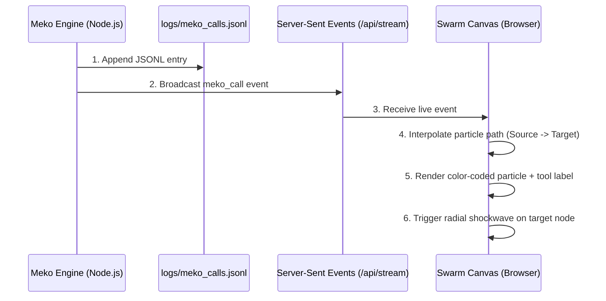

# 🛠️ Campus Grievance Swarm — Code, Architecture & Execution Guide
### hackCBS 9.0 · Meko Challenge · Track B

> **Developer, Judge & Evaluator Manual.**  
> This document details the internal code mechanics, file-by-file responsibilities, execution steps, and an exhaustive step-by-step walkthrough of all demo scenarios.

---

## 1. System Requirements & Setup

The project is built on **Node.js (ES Modules)** with native libraries (`node:http`, `node:fs`, `node:crypto`, `node:events`), requiring zero external npm package installation dependencies. This guarantees instant setup, zero installation lockouts, and portable cross-platform execution.

### Prerequisites
- **Node.js:** v18.0.0 or later (Tested on Node v26.13.0).
- **Operating System:** Windows, macOS, or Linux.
- **Port:** Default `3000` (configurable via `PORT` environment variable).

---

## 2. Codebase Organization & File Roles

```
YUGABYTE Project/
├── package.json                 # Project configuration & npm scripts
├── README.md                    # High-level conceptual overview & problem statement
├── CODE_AND_EXECUTION.md        # Technical execution & scenario guide (this file)
│
├── logs/
│   └── meko_calls.jsonl         # Append-only audit log of every real Meko MCP tool invocation
│
├── data/
│   └── meko_store.json          # Persistent JSON storage for all Meko datapacks
│
├── server/
│   ├── meko_engine.js           # Core Meko engine: datapacks, MCP tools, & JSONL logger
│   ├── swarm_service.js         # Swarm orchestrator: connects agents, tickets, & handoffs
│   ├── server.js                # HTTP server, REST endpoints, SSE stream, & MCP endpoint
│   └── agents/
│       ├── intake.js            # Intake Agent: NLP parse, dedupe, private student datapack
│       ├── department.js        # Department Agent: diagnostics, ETA calculation, canon recall
│       ├── conflict.js          # Conflict Agent: cross-datapack contradiction detector
│       ├── knowledge.js         # Knowledge Keeper: lesson synthesizer & promotion staging
│       └── dean.js              # Dean Agent: reads campus-canon strictly for systemic trends
│
├── public/
│   ├── index.html               # Main dashboard UI with 6 interactive tabs
│   ├── css/
│   │   └── style.css            # Dark glassmorphic design system & glowing status elements
│   └── js/
│       ├── app.js               # UI controller, tab router, form handlers, & scenario orchestrator
│       ├── swarm_canvas.js      # 60 FPS HTML5 canvas engine rendering nodes & moving particle edges
│       └── meko_feed.js         # EventSource SSE listener updating live drawer & telemetry
│
└── test/
    ├── test_meko.js             # Automated verification suite testing B1, B2, B3, B4, B5
    └── test_server.js           # Integration test verifying HTTP, SSE, & MCP endpoints
```

---

## 3. How to Execute the Project

### Step 1: Run the Automated Verification Test Suite
Run the test suite to verify all Track B hard requirements in isolated simulation:
```bash
npm test
```
*Equivalent command:*
```bash
node test/test_meko.js
```

#### What the test verifies:
1. **B1:** One grievance end-to-end live (Case A: Student Riya).
2. **Conflict Detection:** Cross-datapack query across `dept-electricity` and `dept-mess`.
3. **B2:** Caretaker resolution hand-off & lesson extraction.
4. **B2 & Governance:** Direct write blocking to `campus-canon` and explicit human promotion via `memory_promote`.
5. **B3:** Empirical comparison of Case B with Meko ON (30 minutes) vs. Meko OFF (72 hours).
6. **Dean View:** Read-only access to `campus-canon`.
7. **B4:** Exact schema integrity of [`logs/meko_calls.jsonl`](file:///d:/Programming/PYTHON/Pythonn/YUGABYTE%20Project/logs/meko_calls.jsonl).

---

### Step 2: Start the Live Web Application
Start the server:
```bash
npm start
```
*Equivalent command:*
```bash
node server/server.js
```

You will see the startup banner:
```
=======================================================
🚀 Campus Grievance Swarm Server Running
📍 URL: http://localhost:3000
⚡ Meko Call Log: logs/meko_calls.jsonl
🔗 MCP Endpoint: http://localhost:3000/mcp
📡 SSE Live Stream: http://localhost:3000/api/stream
=======================================================
```

---

### Step 3: Open the Dashboard
Open your browser and navigate to:
```
http://localhost:3000
```

---

## 4. Detailed Demo Scenarios Walkthrough (Under the Hood)

The dashboard allows judges and evaluators to interact with all five Track B requirements through an intuitive workflow.

---

### 🎬 Scenario 1: Case A — Student Riya (Initial Problem & Discovery)

#### User Action:
- In the top bar, click **Demo Scenarios ▾** → select **"Case A: Riya's Geyser Tripping"** (or click **"1. Run Case A"** in the **B3 Learning Proof** tab).

#### What Happens in the Code:
1. **Student Input:** Riya Patel submits:  
   *"The geyser in the 2nd floor bathroom gives lukewarm water and then the lights flicker and it completely stops heating."*
2. **Intake Agent ([`server/agents/intake.js`](file:///d:/Programming/PYTHON/Pythonn/YUGABYTE%20Project/server/agents/intake.js)):**
   - Invokes Meko tool `memory_add`: Writes the raw text to `student-riya-private` (`label: "written"`).
   - Invokes Meko tool `memory_search`: Queries `dept-electricity` for existing open tickets with similar location/keywords. Since this is the first report, it registers ticket `TKT-XXXXXX`.
   - Invokes Meko tool `memory_add`: Logs triaged status to `student-riya-private` so Riya's portal displays *"Ticket Registered"*.
3. **Department Agent ([`server/agents/department.js`](file:///d:/Programming/PYTHON/Pythonn/YUGABYTE%20Project/server/agents/department.js)):**
   - Invokes Meko tool `knowledgebase_search`: Queries `campus-canon`. At this point, no prior canon fix exists.
   - Invokes Meko tool `memory_search`: Queries `dept-electricity` for equipment specs (retrieves Venus 25L 2000W geyser on DB-2B).
   - Sets baseline ETA: **4 hours** (requires technician diagnosis and circuit load test).
   - Invokes Meko tool `memory_add`: Records dispatch plan in `dept-electricity`.
4. **Conflict Agent ([`server/agents/conflict.js`](file:///d:/Programming/PYTHON/Pythonn/YUGABYTE%20Project/server/agents/conflict.js)):**
   - Invokes Meko tool `memory_search` on `dept-electricity`: Discovers scheduled Substation 2 outage (14:00 - 17:00).
   - Invokes Meko tool `memory_search` on `dept-mess`: Checks utility pipelines.
   - Detects schedule collision: Electrician was dispatched at 14:30 during the power cut!
   - Flags an alert for Caretaker Ramesh: *"Reschedule technician window to 17:15 after power is restored."*
5. **Caretaker Physical Resolution ([`server/swarm_service.js`](file:///d:/Programming/PYTHON/Pythonn/YUGABYTE%20Project/server/swarm_service.js)):**
   - Electrician Suresh inspects DB-2B panel after power restoration.
   - Diagnosis: The heating coil is fine. The 16A breaker was tripping because hostel corridor space heaters were sharing Phase 1. Suresh shifts the circuit to Phase 2.
   - Caretaker Ramesh records resolution: *"Phase 1 radiator load was tripping 16A breaker. Switched geyser circuit to Phase 2 on subpanel DB-2B. Water output 65°C verified."*
6. **Knowledge Keeper ([`server/agents/knowledge.js`](file:///d:/Programming/PYTHON/Pythonn/YUGABYTE%20Project/server/agents/knowledge.js)):**
   - Synthesizes the core technical takeaway.
   - Invokes Meko tool `memory_add`: Stores candidate lesson in `dept-electricity` with status `pending_human_approval`.
   - Fires notification to Caretaker console.

---

### 🎬 Scenario 2: The Human Promotion Step (B2 & Section 4.1 Governance)

#### User Action:
- In the Caretaker Console (or via the purple alert banner), click **"Review & Confirm Promotion"** (or click **"2. Approve Promotion"** in the **B3 Learning Proof** tab).

#### What Happens in the Code:
1. **Preview Modal Displays:**
   - **Source Datapack:** `dept-electricity`
   - **Candidate Memory ID:** `mem_XXXXXX`
   - **Synthesized Lesson:** *"VERIFIED CANON LESSON: For Block B Floor 2 geyser, tripping issues during winter are caused by phase load imbalance (space heaters on Phase 1), NOT heating coil failure. Solution: Shift geyser breaker to Phase 2 on subpanel DB-2B. Avoid ordering replacement heating coils."*
   - **Human Signer:** `Caretaker Ramesh`
2. **Human Confirmation:** Caretaker clicks **"Confirm & Execute memory_promote →"**.
3. **Meko Engine Execution ([`server/meko_engine.js`](file:///d:/Programming/PYTHON/Pythonn/YUGABYTE%20Project/server/meko_engine.js)):**
   - Validates that `human_approver` is signed.
   - Copies and certifies the record into `campus-canon` with ID `canon_XXXXXX`.
   - Appends entry to `logs/meko_calls.jsonl`:
     ```json
     {"ts": "...", "agent": "knowledge_keeper", "datapack": "campus-canon", "tool": "memory_promote", "label": "promoted", "payload_summary": "Promoted [mem_XXXX] by Caretaker Ramesh...", "result_id": "canon_XXXX"}
     ```
4. **Live Swarm Canvas Animation:**
   - A royal purple particle (`#a855f7`) travels from the Knowledge Keeper to `campus-canon`.
   - A radial purple shockwave pulses outwards as `campus-canon` locks the new verified memory.

---

### 🎬 Scenario 3: Case B With Meko ON (Institutional Learning Demonstrated)

#### User Action:
- In the **B3 Learning Proof** tab, click **"3a. Meko ON (30m)"** (or use the dropdown menu).

#### What Happens in the Code:
1. **Student Input:** Different student Arjun Sen (Block B, Room 212) reports cold water days later:  
   *"Water heater is totally dead again in 2nd floor washroom, no warm water this morning."*
2. **Intake Agent:** Logs raw text to `student-arjun-private` and routes to Department Agent with `useMeko = true`.
3. **Department Agent Context Recall:**
   - Invokes Meko tool `knowledgebase_search` on `campus-canon`.
   - **Match Found!** Recalls `canon_XXXXXX` created during Case A.
4. **Automated Action Adjustment:**
   - The agent reads the canon diagnosis: *"Do NOT replace heating coil. Overload caused by Phase 1. Check Phase 2 breaker on DB-2B."*
   - Sets **ETA to 30 minutes** (instead of 4 to 72 hours).
   - Generates action plan: *"Electrician Suresh dispatched to inspect subpanel DB-2B Phase 2 toggle. Zero replacement parts required."*
5. **Outcome:**
   - The student sees an immediate, believable 30-minute ETA.
   - Caretaker flips the breaker, hot water is restored before morning classes end.
   - **Saved:** 3 days of delay and ₹4,500 in wasted replacement parts.

---

### 🎬 Scenario 4: Case B With Meko OFF (The Control Test)

#### User Action:
- In the **B3 Learning Proof** tab, click **"3b. Meko OFF (72h)"** (or use the dropdown menu).

#### What Happens in the Code:
1. **Execution with `useMeko = false`:**
   - Simulates a traditional, siloed helpdesk system where agents have no access to Meko shared context or `campus-canon`.
2. **Department Agent Blind Evaluation:**
   - The agent cannot search `campus-canon`.
   - Has zero knowledge of the Phase 1 radiator overload or the fix recorded last week.
   - Naive default procedure: Assumes the heating coil is burned out.
   - Generates action plan: *"File purchase order for Venus 25L 2000W heating element. Await delivery from supplier."*
   - Sets **ETA to 72 hours (3 business days)**.
   - Parts cost: **₹4,500**.
3. **Side-by-Side Comparison Matrix:**
   - The UI displays the side-by-side comparison between Meko ON (30m, ₹0) and Meko OFF (72h, ₹4,500).

---

### 🎬 Scenario 5: Dean View (Executive Strategic Intelligence)

#### User Action:
- Click the **Dean View (Canon Only)** tab in the sidebar.

#### What Happens in the Code:
1. **Query Execution ([`server/agents/dean.js`](file:///d:/Programming/PYTHON/Pythonn/YUGABYTE%20Project/server/agents/dean.js)):**
   - The Dean View strictly queries `campus-canon` using `knowledgebase_search`.
   - It is prohibited from reading student private text or transient operational logs.
2. **Intelligence Synthesis:**
   - Detects systemic pattern: Phase 1 imbalances across Block B distribution boards account for repeated winter complaints.
   - Generates institutional recommendation: *"Direct electrical engineering works to rebalance substation phases across Block B and C ahead of winter exams, and update hostel maintenance SOP to verify phase balance before approving part requisitions."*

---

### 🎬 Scenario 6: Meko Call Log Inspector

#### User Action:
- Click the **Meko Call Log** tab in the sidebar.

#### What Happens in the Code:
1. Fetches recent records from [`logs/meko_calls.jsonl`](file:///d:/Programming/PYTHON/Pythonn/YUGABYTE%20Project/logs/meko_calls.jsonl).
2. Displays an interactive table with tool filters (`memory_add`, `memory_search`, `memory_promote`, `knowledgebase_search`) and datapack filters.
3. Every entry contains:
   - `ts`: ISO 8601 timestamp.
   - `agent`: Calling agent name.
   - `datapack`: Target scope.
   - `tool`: Meko MCP tool invoked.
   - `label`: `written` | `recalled` | `shared` | `promoted`.
   - `payload_summary`: Verbatim summary of the memory.
   - `result_id`: Unique memory ID.

---

## 5. How the Live Swarm Canvas Renders Moving Edges

The canvas engine ([`public/js/swarm_canvas.js`](file:///d:/Programming/PYTHON/Pythonn/YUGABYTE%20Project/public/js/swarm_canvas.js)) provides visual feedback for every Meko call:



### The Mathematics Behind the Animation:
1. **Node Resolution:** When a `meko_call` event arrives, the engine identifies the source node (Agent or Datapack) and target node.
2. **Directional Flow:**
   - If the tool is `memory_add` or `memory_promote`: Particle flows from **Agent → Datapack**.
   - If the tool is `memory_search` or `knowledgebase_search`: Particle flows from **Datapack → Agent** (representing recalled memory).
3. **Linear Progress Interpolation:**
   ```javascript
   x(t) = startX + (endX - startX) * progress;
   y(t) = startY + (endY - startY) * progress;
   ```
4. **Tail Rendering:** Draws a glowing trailing gradient along the travel vector.
5. **Shockwave Ripple:** Upon reaching `progress >= 1`, the target node triggers an expanding circular wave that fades as `alpha` decays to 0.

---

## 6. Technical API Reference

### 6.1 REST API Endpoints

| Method | Endpoint | Description | Request Body / Parameters |
|---|---|---|---|
| `GET` | `/api/status` | System health, telemetry, and datapack scopes | None |
| `GET` | `/api/logs` | Fetch call logs from `logs/meko_calls.jsonl` | `?limit=100` |
| `GET` | `/api/stream` | Server-Sent Events live stream | None |
| `POST` | `/api/grievance` | Submit a new student grievance | `{"student_id", "student_name", "room", "text", "useMeko"}` |
| `GET` | `/api/tickets` | Retrieve all registered tickets | None |
| `POST` | `/api/resolve` | Mark ticket resolved & stage canon lesson | `{"ticket_id", "caretaker_name", "diagnosis", "resolution_notes"}` |
| `GET` | `/api/promotions` | List candidate lessons awaiting human approval | None |
| `POST` | `/api/promote` | Execute human-approved promotion to canon | `{"candidate_memory_id", "human_approver", "note"}` |
| `GET` | `/api/dean` | Strategic intelligence from `campus-canon` | `?q=maintenance` |
| `POST` | `/api/scenario/case-a` | Trigger Case A demo scenario | None |
| `POST` | `/api/scenario/case-b` | Trigger Case B demo scenario | `{"useMeko": true}` or `{"useMeko": false}` |
| `POST` | `/api/reset` | Clear store & re-seed baseline data | None |

---

### 6.2 Standard MCP Protocol Endpoint (`POST /mcp`)

The server implements a Model Context Protocol JSON-RPC endpoint:

#### List Tools:
```bash
curl -X POST http://localhost:3000/mcp \
  -H "Content-Type: application/json" \
  -d '{"jsonrpc": "2.0", "id": 1, "method": "tools/list", "params": {}}'
```

#### Call Tool (`memory_search`):
```bash
curl -X POST http://localhost:3000/mcp \
  -H "Content-Type: application/json" \
  -d '{
    "jsonrpc": "2.0",
    "id": 2,
    "method": "tools/call",
    "params": {
      "name": "memory_search",
      "arguments": {
        "agent": "intake",
        "datapack_id": "dept-electricity",
        "query": "Block B geyser"
      }
    }
  }'
```

---

## 7. Troubleshooting & FAQ

- **Port Conflict:** If port 3000 is occupied, run with `PORT=3001 node server/server.js`.
- **Resetting the Demo:** Click the **🔄 Reset** button in the top header or call `POST /api/reset` to restore a clean baseline state.
- **Verifying Disk Persistence:** Inspect [`logs/meko_calls.jsonl`](file:///d:/Programming/PYTHON/Pythonn/YUGABYTE%20Project/logs/meko_calls.jsonl) and [`data/meko_store.json`](file:///d:/Programming/PYTHON/Pythonn/YUGABYTE%20Project/data/meko_store.json) to confirm that all events and memories persist across server restarts.
